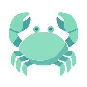

<div align="center">



# 青蟹 Web


</div>

你说得对，但是 “青蟹” 是四川轻化工大学开放原子开源协会设计并制作的协会管理系统，包括协会介绍、人员管理、公告/比赛管理等多种常用功能。

访问青蟹 Web：<https://suseoaa.com>

“青蟹” 项目共分为 3 个部分，本仓库为其 Web 前端部分，基于 Vue 3 框架与 PrimeVue v4 组件库构建。关于其它部分，欢迎各位查阅：

- 后端：[suse-oaa-backend](https://github.com/suse-edu-cn/suse-oaa-backend)
- Android App：[suse-oaa-app](https://github.com/suse-edu-cn/suse-oaa-app)

## 主要功能及 Roadmap

- 首页介绍
- 协会用户系统
- 招新 / 换届申请、面试及管理
- 公告消息管理
- [TODO] 比赛发布及管理
- [TODO] 统一身份认证系统
- ......

## 开发者食用方法
请先确定计算机已经安装 Node.js 环境 (版本 >= 24) 和 pnpm 包管理器 (版本 >= 11)，然后 clone 本项目并安装相关依赖。

```bash
git clone https://github.com/suse-edu-cn/oaa-frontend
pnpm install
```

接下来启动 dev server。修改完成后可进行 lint 和 format，然后再构建生产页面。
```bash
pnpm dev
pnpm format
pnpm lint
pnpm build
```

如果你是青蟹 Web 开发者，请在实验室内网环境下配置 `scripts/deploy/deploy.local.json`，配置好 ssh、scp 与 mc，然后运行：
```bash
pnpm deploy
```
即可将构建好的生产页面部署到青蟹的前端服务器。

> [!NOTE]
> 实验室内部正在研发前端网页部署基建工具，部署相关功能可能在未来迎来大改，比如接入相关 SDK。拥有权限的同学可在内部 Git 系统搜索项目代号 `4nim0sity` 查看相关项目开发进度。

## 其它
本项目部分内容使用了 AI 进行辅助开发，测试环境完全由 AI 完成。[青蟹图标](./public/oaa.svg)为 AI 生成，详情请见 commit [`c443197`](https://github.com/suse-edu-cn/oaa-frontend/commit/c443197f496f7dd05018ffc9057c63dc5e2c6000)。

(C) SUSE OAA Project Dept. Licensed under [GPL-3.0](./LICENSE).
